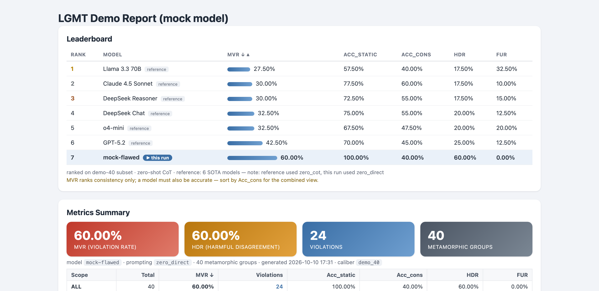

# LGMT — Logic-Grounded Metamorphic Testing for LLM Logical Reasoning

[](https://github.com/MaxwelsDonc/lgmt-tool/actions/workflows/ci.yml)
[](https://www.python.org)
[](LICENSE)

**Check whether an LLM reasons *consistently*: rewrite its logical problems
into provably equivalent variants, ask both, and flag every self-contradiction.**

LGMT is the tool companion of *"LGMT: Logic-Grounded Metamorphic Testing for
Evaluating the Reasoning Reliability of LLMs"* (Knowledge-Based Systems, in
press). It packages that study's methodology as a reusable tool:

- **20 first-order-logic metamorphic relations** (equivalence-law rewriting
  of FOL syntax trees — De Morgan, contraposition, quantifier dualities,
  premise restructuring, symbol renaming; each guarded by Z3-based
  equivalence tests), with a three-method plugin API for adding your own;
- a **five-command CLI** (`demo` / `build-mgs` / `run` / `report` / `audit`)
  targeting any OpenAI-compatible endpoint — commercial APIs or local
  vLLM/Ollama — plus a local Gradio web demo;
- a **self-contained HTML report**: your model ranked against six reference
  LLMs, per-MR metrics, and side-by-side violation evidence;
- a bundled **3,091-group evaluation benchmark** with documented provenance.



## Try it

**Option 1 — Docker (nothing to install beyond Docker):**

```bash
docker build -t lgmt .
docker run --rm lgmt        # offline demo; report lands in ./demo_output via volume if mounted
```

**Option 2 — local install** (requires **Python ≥ 3.10**; no API key needed
for the offline demo):

```bash
git clone https://github.com/MaxwelsDonc/lgmt-tool.git
cd lgmt-tool
python -m venv .venv && source .venv/bin/activate   # Windows PowerShell: .venv\Scripts\Activate.ps1
pip install -e .

lgmt demo            # 40 groups, offline mock model → demo_output/report.html
lgmt demo --full     # same tour on the full 3,091-group benchmark
```

Open `demo_output/report.html` — the leaderboard above is what you get.

**Evaluate a real model** (any OpenAI-compatible endpoint):

```bash
export LGMT_API_KEY=sk-...                                     # and LGMT_BASE_URL if not OpenAI
lgmt run --mgs data/metamorphic_group/processed_mgs_core/processed_mgs_200.jsonl \
         --model your-model --output results.jsonl
lgmt report --results results.jsonl --output report.html       # your model joins the leaderboard
```

Config precedence: CLI flags > `LGMT_API_KEY`/`LGMT_BASE_URL`/`LGMT_MODEL`
env vars > `config.yaml` > defaults. The full benchmark costs **6,182 API
calls** per model (~10⁷ tokens; multiply by your provider's price). To test
your own premise–conclusion cases, run `lgmt build-mgs --input my_cases.jsonl
--output my_mgs.jsonl` first — no FOL knowledge or ground-truth labels needed.

On Windows consoles, `set PYTHONIOENCODING=utf-8` keeps logic symbols
printing cleanly; if anything else misbehaves, use the Docker option.

## Tests

```bash
pip install -e ".[dev]"
pytest        # 73 passed, 5 skipped (rare-MR applicability skips)
```

MR equivalence (Z3-backed), label canonicalization, mock self-consistency,
CLI end-to-end, and report rendering. CI runs the same suite on
Windows/macOS/Linux × Python 3.10–3.13.

## Extending LGMT with a custom MR

```python
from lgmt.core.structure import MetamorphicRelation, TestCase

class MyMR(MetamorphicRelation):
    def check_applicability(self, tc: TestCase) -> bool: ...
    def source_templates(self) -> list[str]: return []
    def transform(self, tc: TestCase) -> TestCase: ...
```

Implement the three methods and add the class to `lgmt.mrs` — it is picked
up by `lgmt build-mgs` automatically. The 20 built-in MRs use exactly this
API, and their equivalence preservation is guarded by
`tests/test_mr_equivalence.py` (Z3-backed).

## Repository layout

```
lgmt/      the Python package (core / mrs / prompts / models / utils / webapp)
data/      source test cases and the 3,091-group benchmark (see data/README.md)
docs/      assets (report screenshot, TikZ architecture figure)
tools/     MR regression checker — `python tools/mr_smoke_compare.py`
tests/     pytest suite
```

Full RQ1–RQ4 experiment scripts live in the companion paper's research
repository, not here.

## License & attribution

Code: [MIT](LICENSE). The bundled data derives from FOLIO, LogicNLI, and
ProverQA under their own terms — see
[data/README.md](data/README.md). If you use this tool, please cite the
companion paper.

## Citation

```bibtex
@article{zhou2026lgmt,
  author  = {Zhou, Zenghui and others},
  title   = {LGMT: Logic-Grounded Metamorphic Testing for Evaluating the
             Reasoning Reliability of {LLMs}},
  journal = {Knowledge-Based Systems},
  year    = {2026},
  note    = {in press},
}
```
