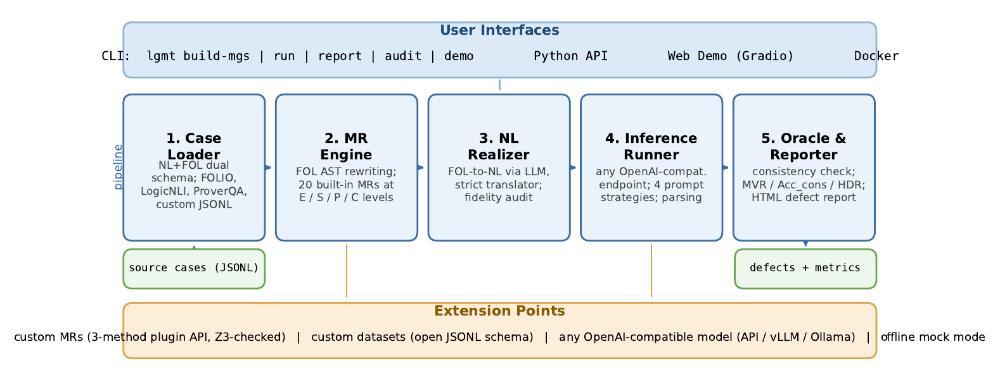

# LGMT — Logic-Guided Metamorphic Testing for LLM Logical Reasoning

[](https://github.com/MaxwelsDonc/lgmt-tool/actions/workflows/ci.yml)
[](LICENSE)

**LGMT** evaluates the logical-reasoning reliability of large language models
with *metamorphic testing grounded in first-order logic (FOL)*. It applies
20 semantics-preserving FOL transformations (metamorphic relations, MRs) to
entailment test cases, probes the model under test on each source/follow-up
pair, and flags **metamorphic violations** — inconsistent verdicts that
expose fragile, non-invariant reasoning.



## Features

- **20 FOL-grounded metamorphic relations** across four families:
  - *Equivalence* (MR-E1.1–E1.6, MR-E2.1–E2.4): implication elimination,
    negation normalization, quantifier lifting, structural normalization,
    alpha-renaming, canonical quantifier ordering, redundancy/tautology/
    identity elimination, distributivity.
  - *Symbol* (MR-S1–S2): constant and predicate renaming invariance.
  - *Premise-set* (MR-P1–P5): reordering, duplication, irrelevant extension,
    fusion, and decomposition of premises.
  - *Conclusion* (MR-C1–C3): conjunction with truth, disjunction with
    falsehood, double negation.
- **Pluggable model layer**: any OpenAI-compatible endpoint (OpenAI, vLLM,
  Ollama, proxies); reasoning models are handled without sampling
  parameters; httpx connection pooling and retry built in.
- **Offline mock mode**: a deterministic mock model with `consistent` and
  `flawed` personas lets you run the full pipeline — including the HTML
  report — with no API key and no network.
- **HTML evaluation reports**: per-group verdict badges, metrics summary,
  and side-by-side source/follow-up FOL comparisons.
- **Metrics**: MVR (Metamorphic Violation Rate), static/consistency
  accuracy, HDR (Harmful Disagreement Rate), and FUR (Flaw-persisting
  Unanimous Rate), overall and per MR category.

## Installation

```bash
pip install -r requirements.txt
pip install -e .
```

Or with conda:

```bash
conda env create -f environment.yml
conda activate lgmt_env
pip install -e .
```

For running the test suite:

```bash
pip install -r requirements-dev.txt
pytest
```

## Quickstart

Try LGMT end to end in offline mock mode (no key, no network):

```bash
lgmt demo
# writes demo_output/results.jsonl and demo_output/report.html
```

Point LGMT at a real model and evaluate metamorphic consistency:

```bash
export LGMT_API_KEY=sk-...
export LGMT_BASE_URL=https://api.openai.com/v1   # any OpenAI-compatible endpoint

# 1. build metamorphic groups from source test cases
#    (--no-realize keeps the tagged FOL skeleton; without it, follow-up
#    natural language is regenerated by an LLM back-translation)
lgmt build-mgs --input data/source_test_case/folio_source_test_case.jsonl \
               --output mgs.jsonl --no-realize

# 2. run inference + metamorphic oracle
lgmt run --mgs mgs.jsonl --output results.jsonl \
         --model gpt-4o --prompting zero_cot --workers 50

# 3. metrics + HTML report
lgmt report --results results.jsonl --mgs mgs.jsonl --output report.html
```

Other subcommands:

```bash
lgmt audit --mgs mgs.jsonl --output audit.jsonl   # back-translation fidelity check
lgmt build-mgs --help                              # all options
```

Configuration precedence: CLI flags > `LGMT_API_KEY` / `LGMT_BASE_URL` /
`LGMT_MODEL` environment variables > `config.yaml` (copy
`config.example.yaml`) > built-in defaults.

## Docker

```bash
docker build -t lgmt .
docker run --rm lgmt                  # offline demo (mock model, no key needed)
docker run --rm lgmt lgmt demo        # same, explicit
docker run --rm -p 7860:7860 lgmt lgmt-web   # Gradio web demo on :7860
```

The default command runs `lgmt demo`, so a successful container start is
self-verifying without any API key. The core image does not include gradio;
`lgmt-web` prints an install hint unless you extend the image with
`requirements-web.txt`. See [DEPLOY.md](DEPLOY.md) for details — the image
is also built (without pushing) on every push by GitHub Actions.

## Web demo (Gradio)

A three-tab Gradio UI ships with the package (offline mock demo, run
against your own endpoint, and a report browser):

```bash
pip install -r requirements-web.txt
python -m lgmt.webapp        # serves http://0.0.0.0:7860
```

The demo is launched locally (see the Gradio section above); we do not
host a public instance. Deployment options (including HF Spaces) are
documented in [DEPLOY.md](DEPLOY.md).

## Data

- `lgmt/demo/demo_mgs.jsonl` — 40 bundled metamorphic groups (covering the
  E/S/P/C categories) used by `lgmt demo`.
- `data/source_test_case/` — source entailment cases from FOLIO, LogicNLI,
  and ProverQA used to build MGs.
- `data/metamorphic_group/processed_mgs_core/processed_mgs_200.jsonl` — the
  3,091-group evaluation benchmark used in the paper's experiments
  (see `data/README.md` for provenance and licensing).

## Extending LGMT with a custom MR

Implement three methods on the `MetamorphicRelation` base class (the same
API shown in the paper's listing):

```python
from lgmt.core.structure import MetamorphicRelation, TestCase

class MyMR(MetamorphicRelation):
    def __init__(self):
        self.index = "MR-X1"
        self.name = "My Relation"

    def check_applicability(self, test_case: TestCase) -> bool:
        ...  # does the source case contain the pattern this MR rewrites?

    def source_templates(self) -> list[str]:
        return ["A -> B"]  # minimal applicable patterns (may return [])

    def transform(self, source_case: TestCase) -> TestCase:
        ...  # return the follow-up case (Γ, q) => (Γ', q')
```

Formula-level rewrites can subclass `MetamorphicTransform`
(`lgmt.mrs.equivalence.equivalence_utils`) and only implement a
`LogicTransformer` + `LogicChecker` visitor. MRs that rename symbols should
record their mapping in `followup_case.metadata["mapping"]`. Equivalence
preservation of every MR is guarded by `tests/test_mr_equivalence.py`, which
symbolically checks source/follow-up equivalence with Z3.

## Repository layout

```
lgmt/               the Python package (core / mrs / prompts / models / utils)
experiments/        scripts that compute the paper's RQ1–RQ4 tables/figures
data/               source test cases and the processed MG evaluation set
docs/               assets (architecture figure)
tools/              MR regression smoke checker
tests/              pytest suite (MR equivalence, labels, mock, CLI)
```

## Citation

The framework and the 20 MRs are described in the companion KBS paper
(**TODO: full citation placeholder**). If you use LGMT, please also cite the
ICSE 2027 Tool Demonstration paper (**TODO: citation placeholder**).

## License

[MIT](LICENSE) — Copyright (c) 2026 Zenghui Zhou and contributors.

Note: the source datasets that the bundled evaluation data derives from
(FOLIO, LogicNLI, ProverQA) carry their own licenses — see
[data/README.md](data/README.md) for the full data-provenance statement.
