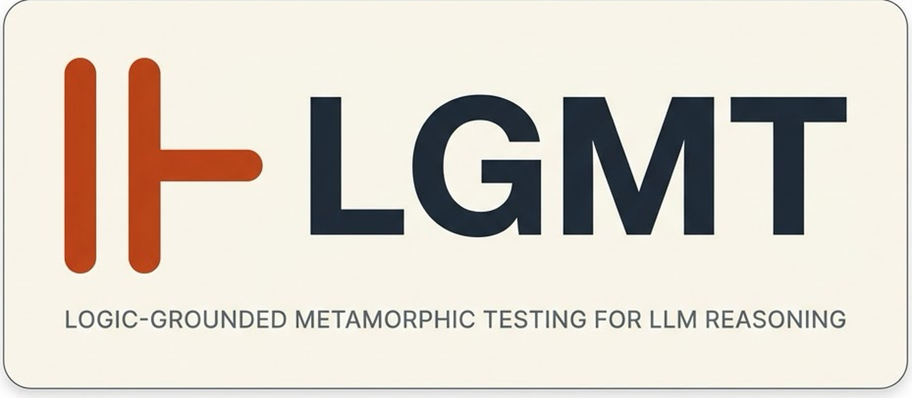
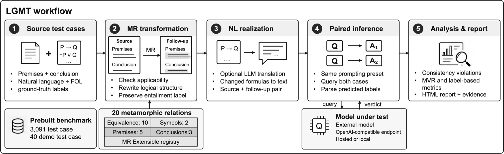
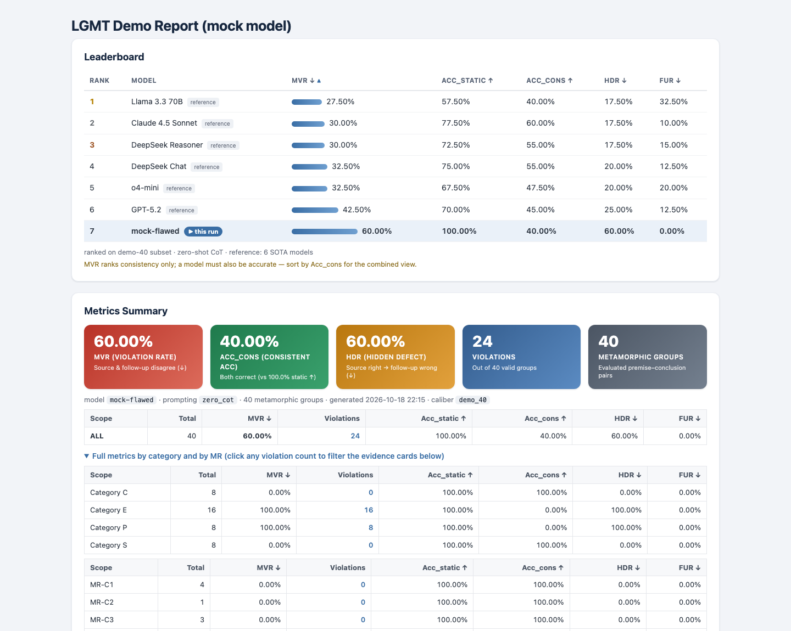

<p align="center">
  
</p>

<p align="center">
  <a href="https://github.com/MaxwelsDonc/lgmt-tool/actions/workflows/ci.yml"></a>
  <a href="https://www.python.org"></a>
  <a href="LICENSE"></a>
  <a href="https://youtu.be/gou4opptu1U"></a>
</p>

<p align="center">
  <b>Rewrite a logical problem into provably equivalent variants, ask the model both,<br>
  and flag every self-contradiction — no ground-truth labels required.</b>
</p>

<p align="center">
  <a href="https://youtu.be/gou4opptu1U">▶ 4-minute demo</a> ·
  <a href="https://zhouzenghui.site/lgmt-tool/">Documentation</a> ·
  <a href="https://github.com/MaxwelsDonc/lgmt-tool">GitHub</a> ·
  <a href="https://github.com/MaxwelsDonc/lgmt-tool/issues">Issues</a>
</p>

---

LGMT is the tool companion of *“LGMT: Logic-Grounded Metamorphic Testing for
Evaluating the Reasoning Reliability of LLMs”* (Knowledge-Based Systems, in
press). It packages that study's methodology into an extensible testing
pipeline.

**Contents:**
[Quickstart](#quickstart) ·
[How it works](#how-it-works) ·
[Key metrics](#key-metrics--terms) ·
[Example report](#example-report) ·
[Workflows](#three-workflows) ·
[CLI](#cli-reference) ·
[Web Studio](#web-studio) ·
[Custom MRs](#custom-mrs) ·
[Configuration](#configuration) ·
[Benchmark](#benchmark-and-data) ·
[Tests](#tests-and-ci) ·
[Troubleshooting](#troubleshooting) ·
[Contributing](#contributing) ·
[Citation](#citation)

## Why LGMT

- **Label-free.** Static benchmarks score each query against a fixed label;
  LGMT instead compares a case with a provably equivalent follow-up and flags
  the pairs where the model disagrees — no oracle needed.
- **Logic-grounded.** Metamorphic relations rewrite first-order-logic syntax
  trees and are guarded by Z3, not applied to surface text where meaning can
  silently drift.
- **Extensible.** A custom MR is a small Python class; it is verified for
  equivalence on registration and then behaves like the 20 built-in ones.
- **Practical.** CLI and a zero-dependency Web Studio, any OpenAI-compatible
  endpoint (hosted or local), an offline mock mode, and self-contained HTML
  reports with side-by-side FOL/NL diffs and drill-down evidence.

## At a glance

| 20 | 3,091 | 6 | 2 |
|:--:|:--:|:--:|:--:|
| built-in MRs across four levels | metamorphic groups in the bundled benchmark | reference LLMs on the report leaderboard<sup>1</sup> | interfaces — CLI and Web Studio |

<sup>1</sup> GPT-5.2, o4-mini, Claude 4.5 Sonnet, DeepSeek Chat, DeepSeek
Reasoner, and Llama 3.3 70B — your model is ranked against all six.

## Quickstart

> **No API key, no network.** The offline tour uses a deterministic mock model
> on bundled data and finishes in well under a minute.

### Option A — Docker

```bash
docker pull ghcr.io/maxwelsdonc/lgmt-tool:latest      # prebuilt, linux/amd64 + linux/arm64
docker tag  ghcr.io/maxwelsdonc/lgmt-tool:latest lgmt # keep the commands below unchanged
docker run --rm -v "$(pwd)/demo_output:/app/demo_output" lgmt
```

The image is public — no `docker login` needed. Building from source
(`docker build -t lgmt .`, a few minutes) is only needed if GHCR is unreachable
or you changed the code; it produces the same image.

<details>
<summary>Run any CLI workflow inside the container</summary>

The entrypoint passes commands through, so append a command after the image
name and mount a folder to get outputs back:

```bash
docker run --rm \
  -e LGMT_API_KEY=sk-... -e LGMT_BASE_URL=https://api.deepseek.com \
  -v "$(pwd)/out:/app/out" \
  lgmt lgmt run --mgs demo --model deepseek-flash --output /app/out/results.jsonl
```

For repeated runs, keep one container alive and `docker exec` into it:

```bash
docker run -d --name lgmt -v "$(pwd)/out:/app/out" lgmt sleep infinity
docker exec lgmt lgmt <command>
docker rm -f lgmt
```
</details>

### Option B — pip

Requires **Python ≥ 3.10**.

```bash
git clone https://github.com/MaxwelsDonc/lgmt-tool.git
cd lgmt-tool
python -m venv .venv && source .venv/bin/activate   # Windows: .venv\Scripts\Activate.ps1
pip install -e .

lgmt demo          # 40 groups, offline mock model → demo_output/report.html
lgmt demo --full   # same tour on the full 3,091-group benchmark
```

Open `demo_output/report.html` in any browser — the leaderboard, metric cards,
and violation evidence render completely offline.

**Prefer a UI?** Launch the Web Studio (see [Web Studio](#web-studio)) and open
<http://localhost:7860>:

```bash
lgmt web --port 7860
# or via Docker: docker run --rm -p 7860:7860 lgmt lgmt-web
```

## How it works

<p align="center">
  
</p>

1. **Cases Loader** ingests premise–conclusion cases in natural language, FOL,
   or both, and validates every formula.
2. **MR Engine** applies one of 20 metamorphic relations to the FOL syntax
   tree, producing a provably equivalent follow-up case.
3. **NL Realizer** rewrites only the statements that actually changed, keeping
   the rest of the case verbatim.
4. **Inference Runner** queries the model on the source/follow-up pair with
   the same prompting preset.
5. **Analysis & Report** compares verdicts and compiles consistency metrics,
   per-MR breakdowns, and evidence cards into a standalone HTML report.

## Key metrics & terms

| Term | Meaning |
|---|---|
| **MG** (metamorphic group) | one source case plus its provably equivalent follow-up — the unit LGMT evaluates |
| **MR** (metamorphic relation) | a logic-law rewrite of the FOL syntax tree (De Morgan, quantifier duality, …) that is verified with Z3 |
| **MVR ↓** | Metamorphic Violation Rate — fraction of groups where source and follow-up verdicts disagree |
| **HDR ↓** | Hidden Defect Rate — fraction of groups judged correctly on source but flipped to wrong on follow-up |
| **FUR ↓** | False Unreported Rate — fraction of groups where both verdicts are wrong yet consistent |
| **Acc_cons ↑** | Consistent Accuracy — fraction of groups where *both* source and follow-up verdicts are correct |

Lower is better for MVR/HDR/FUR; higher is better for Acc_cons. MVR ranks
consistency alone — pair it with accuracy (Acc_cons) for the combined view.

## Example report

Everything below is a real, unedited render of what `lgmt demo` produces —
a single self-contained HTML file you can open offline and share as-is:

<p align="center">
  
</p>

Your model appears on the leaderboard against the six reference models, with
MVR/accuracy/HDR/FUR per category and per MR; clicking any violation count
filters the evidence cards that follow, each showing the source and follow-up
cases side by side with their FOL/NL renderings.

## Three workflows

| # | Workflow | You need | Commands |
|:-:|---|---|---|
| 1 | **Quick offline tour**<br><sub>experience LGMT in 30 s</sub> | nothing — no key, no network | `lgmt demo` (40 groups) · `lgmt demo --full` (3,091) |
| 2 | **Benchmark a model**<br><sub>rank an LLM against six SOTA models</sub> | an API key, or a local vLLM / Ollama URL | `lgmt run --mgs benchmark --model <model> --output results.jsonl`<br>`lgmt report --results results.jsonl --output report.html` |
| 3 | **Test custom cases**<br><sub>audit your own domain rules</sub> | an API key + a `.jsonl` file of premise–conclusion pairs (plain English or NL+FOL; no labels) | `lgmt build-mgs --input cases.jsonl --output my_mgs.jsonl --model <model>`<br>`lgmt run --mgs my_mgs.jsonl --model <model> --output my_res.jsonl`<br>`lgmt report --results my_res.jsonl --output my_report.html` |

Step-by-step walkthroughs: [Benchmark a model](#benchmark-a-model) ·
[Test your own cases](#test-your-own-cases) · [Audit fidelity](#audit-fidelity)

## CLI reference

| Command | What it does |
|---|---|
| `lgmt demo` | End-to-end offline tour on 40 groups (`--full`: 3,091) |
| `lgmt build-mgs` | Apply MRs to source cases; optionally re-realize changed statements in NL |
| `lgmt run` | Query the model on every source/follow-up pair and record verdicts |
| `lgmt report` | Compile a standalone HTML report (leaderboard, per-MR tables, evidence cards) |
| `lgmt audit` | Judge whether re-generated NL still preserves the FOL structure |
| `lgmt list-mrs` | List every registered MR, including custom ones |
| `lgmt web` | Launch the Web Studio (stdlib only) |

Run `lgmt <command> --help` for the full flag list.

## Web Studio

The built-in studio has no dependencies beyond the package itself and mirrors
the three workflows: **1. Quick Demo**, **2. Benchmark Your Model**, and
**3. Test Custom Cases** — with live progress polling and inline report
rendering.

```bash
lgmt web --port 7860           # native, zero extra dependencies
lgmt web --gradio --port 7860  # optional Gradio wrapper (requirements-web.txt)
```

## Workflows in detail

### Benchmark a model

Any OpenAI-compatible endpoint works — OpenAI, DeepSeek, a Claude proxy, a
local vLLM or Ollama server:

```bash
export LGMT_API_KEY=sk-...
export LGMT_BASE_URL=https://api.deepseek.com
lgmt run --mgs benchmark --model deepseek-flash --output results.jsonl
lgmt report --results results.jsonl --output report.html
```

- **Shorthands.** `--mgs benchmark` → `data/metamorphic_group/processed_mgs_core/processed_mgs_3091.jsonl`;
  `--mgs demo` → the 40-group fast subset. Explicit paths also work.
- **Cost.** The full 3,091-group benchmark issues one judgment per source and
  per follow-up case — **6,182 API calls** per model, on the order of
  **10⁷ tokens** in total (order-of-magnitude estimate). Start with
  `--mgs demo` (80 calls) to check credentials and output parsing.
- **Reasoning models** (e.g. `deepseek-reasoner`, OpenAI o-series): no
  `temperature` is sent, and when a response is truncated
  (`finish_reason="length"`) the token budget escalates automatically from
  8,192 to 65,536. Answers emitted only in `reasoning_content` are accepted.
- **Failures are visible.** Groups whose calls never succeed are recorded as
  failed, excluded from metrics, and called out in the report banner.

### Test your own cases

One case = a few premise lines plus one conclusion. Plain English, Chinese,
FOL, or JSONL all work: the loader sniffs the format, an LLM synthesizes any
missing logic, and NLTK validates every formula.

```bash
lgmt build-mgs --input examples/custom_cases.example.jsonl \
               --output my_mgs.jsonl --model deepseek-flash
lgmt run --mgs my_mgs.jsonl --model deepseek-flash --output my_results.jsonl
lgmt report --results my_results.jsonl --output my_report.html
```

Records that already carry `premises_logic` / `conclusion_logic` are used
as-is, so `--mock` and `--no-realize` run fully offline for them.

### Audit fidelity

Back-translation can drift: the follow-up formula is equivalent, but the
sentence shown to the model may not be. `lgmt audit` replays every statement
that `build-mgs` re-realized through an independent judge model:

```bash
lgmt audit --mgs my_mgs.jsonl --output audit.jsonl --model <judge-model>
```

Each record carries the FOL formula, the generated sentence, a `valid` verdict,
and the `judge_model` that produced it. `my_mgs.jsonl` must come from a run
with realization enabled — groups built with `--no-realize` contain no
re-generated text and are rejected with an explanatory message.

## Custom MRs

Inspect the registry at any time:

```bash
lgmt list-mrs
```

A custom MR subclasses `MetamorphicRelation` and implements four methods:

<details>
<summary>Show the minimal skeleton</summary>

```python
from lgmt.core.structure import MetamorphicRelation, TestCase

class MyMR(MetamorphicRelation):
    def __init__(self):
        self.index = "MR-CX"          # unique id, shown in reports
        self.name = "My Relation"     # human-readable name

    def check_applicability_logic(self, fol: str) -> bool:
        ...                            # can a single FOL formula use this MR?

    def source_templates(self) -> list[str]:
        return []                      # minimal applicable patterns ([] = universal)

    def check_applicability(self, tc: TestCase) -> bool:
        ...                            # can this test case use this MR?

    def transform(self, tc: TestCase) -> TestCase:
        ...                            # return the follow-up case (Γ, q) => (Γ', q')
```
</details>

Every custom MR is verified for logical equivalence with Z3 before it can run
(five standard FOL samples). Three ways to register it:

- **Web Studio drawer** — in Workflow 3 click `➕ Register Custom MR`, edit the
  pre-filled template (the paper's Listing 1), and press *Verify with Z3 &
  Register*. A green bar confirms `Z3 Equivalence Verified (5/5)`.
  *(Executes Python locally — only paste code you trust.)*
- **CLI file loading** — pass a `.py` file to any MR-consuming command:
  ```bash
  lgmt list-mrs --mr-file examples/custom_mr_example.py
  lgmt build-mgs --input my_cases.jsonl --output my_mgs.jsonl \
                 --mr-file examples/custom_mr_example.py --mr MR-CX --no-realize
  ```
  [`examples/custom_mr_example.py`](examples/custom_mr_example.py) is the
  runnable Listing 1 reference.
- **Package drop-in** — place the class anywhere under `lgmt/mrs/`; it is
  discovered automatically on the next import.

## Configuration

| Variable | Purpose | Default |
|---|---|---|
| `LGMT_API_KEY` | key for the OpenAI-compatible endpoint | — (required for real runs) |
| `LGMT_BASE_URL` | endpoint base URL, e.g. `https://api.deepseek.com` | — (required unless set in `config.yaml`) |
| `LGMT_MODEL` | model name or alias | `gpt-4o` |

Precedence, low to high: built-in defaults < `config.yaml` < `LGMT_*` env vars <
CLI flags. A minimal `config.yaml` (copy [`config.example.yaml`](config.example.yaml)):

```yaml
model:
  name: deepseek-flash            # or an alias expanded via `aliases` below
  base_url: "https://api.deepseek.com"
  temperature: 0.0                # ignored for reasoning models
  aliases:
    chatgpt: gpt-4o               # CLI/model-name -> served-model-name

inference:
  prompting: zero_direct          # zero_direct | zero_cot | few_direct | few_cot
  max_workers: 100                # thread-pool size for inference
```

If the key is missing on an interactive terminal, the CLI prompts for it with
hidden input and keeps it in memory only.

## Benchmark and data

| Set | Groups | Use |
|---|---:|---|
| `demo` | 40 | fast credential/parsing check (`lgmt demo`, `--mgs demo`) |
| `benchmark` | 3,091 | full evaluation; derived from FOLIO, LogicNLI, and ProVerQA |

Provenance, per-source licenses, and rebuild notes live in
[`data/README.md`](data/README.md). The full RQ1–RQ4 experiment scripts ship
with the paper's review package and are available on request.

## Tests and CI

```bash
pip install -e ".[dev]"
pytest
```

The suite covers Z3-backed MR equivalence (`tests/z3check.py`), label
canonicalization, mock self-consistency, NL→FOL synthesis, custom-MR
discovery, CLI end-to-end runs, parse-failure handling, and report/web
rendering. CI runs it on Windows/macOS/Linux; the matrix spot-checks Python
3.10 and 3.13 (3.11 and 3.12 remain supported).

## Repository layout

```
lgmt/      package — core / mrs / prompts / models / utils / webapp
data/      source test cases and the 3,091-group benchmark (see data/README.md)
docs/      Sphinx sources, published at https://zhouzenghui.site/lgmt-tool/
examples/  custom-case template and multi-model driver
tests/     pytest suite (Z3 equivalence, CLI, report, web)
tools/     MR regression checker — python tools/mr_smoke_compare.py
```

## Troubleshooting

<details>
<summary><b><code>lgmt audit</code> reports “nothing to audit”</b></summary>

The MG file has no `realized_items`. Build it with realization enabled
(omit `--no-realize`); the bundled `demo`/`benchmark` sets were realized in the
offline pipeline and do not carry this metadata.
</details>

<details>
<summary><b><code>ghcr.io</code> is unreachable</b></summary>

Build locally with `docker build -t lgmt .`, or skip Docker entirely and use
the pip install above.
</details>

<details>
<summary><b>Windows console prints garbled logic symbols</b></summary>

Run `set PYTHONIOENCODING=utf-8` (or `$env:PYTHONIOENCODING="utf-8"` in
PowerShell) before invoking `lgmt`.
</details>

<details>
<summary><b>Every call fails with 401/403</b></summary>

Check three things: the key is valid, `LGMT_BASE_URL` points at the
OpenAI-compatible root (not a full `/chat/completions` path), and the model
name matches what the endpoint serves. Failed groups are excluded from metrics
and flagged in the report.
</details>

## Contributing

Bug reports, feature requests, and PRs are welcome. Please open an issue at
[github.com/MaxwelsDonc/lgmt-tool/issues](https://github.com/MaxwelsDonc/lgmt-tool/issues)
before making larger changes, and run `pytest` locally before submitting.

## Citation

```bibtex
@article{zhou2026lgmt,
  author  = {Zhou, Zenghui and others},
  title   = {LGMT: Logic-Grounded Metamorphic Testing for Evaluating the
             Reasoning Reliability of {LLMs}},
  journal = {Knowledge-Based Systems},
  year    = {2026},
  note    = {in press},
}
```

## License

Code: [MIT](LICENSE). The bundled data derives from FOLIO, LogicNLI, and
ProverQA under their own terms — see [`data/README.md`](data/README.md).
